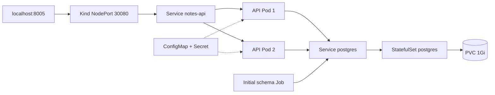

# Understanding the cluster components

[Português](guide.md) · [Back to the project](../README.en.md)

Run commands from the repository root.

## From Docker to Kubernetes



The application image stays the same. What changes is how the environment is declared and observed:

| Component | Role in this lab |
| --- | --- |
| kind | Creates one control plane and one worker as Docker containers |
| Namespace | Groups application resources under `notes-lab` |
| Deployment | Maintains two API replicas and manages their rollouts |
| Service | Selects Pods by labels and supplies a stable address |
| ConfigMap | Holds the connection host, database and username |
| Secret | Holds the password, mounted as a file |
| StatefulSet | Maintains PostgreSQL identity and volume association |
| PVC | Requests 1Gi from kind's `standard` StorageClass |
| Job | Creates the initial table before the API starts |

Manifests live under `manifests/`. `lab.sh up` applies namespace/Secret, starts the database, waits for readiness, runs the Job and only then applies the API. The Job uses the image's existing `migrate.py`: `CREATE TABLE IF NOT EXISTS`, not versioned migrations. This also avoids two replicas racing to create the first table. The API entrypoint still checks the schema on startup.

## Isolation and setup

Pinned versions: kind 0.33.0, Kubernetes 1.37.0 and kubectl 1.37.1. Node, API and PostgreSQL images are pinned by digest. Binary downloads are compared with official checksums, without independent signature verification of those checksum files.

Tools install only under `.local/bin/`, preserving any existing password. Kubeconfig also stays in `.local/`, with mode 0600 where Linux permissions apply. Account for Windows ACLs on NTFS/DrvFS. Never publish kubeconfig or Secret contents.

Kind uses privileged containers and requires Docker authority. Allow several GB of memory and image storage. Local validation used WSL with about 15GiB RAM available to Linux; other environments can have different limits.

The script refuses to adopt an existing `devops-notes` cluster without its `.local/cluster-owned` marker. Commands explicitly select kubeconfig/context. This project does not depend on another lab's cluster or credentials.

## Probes and the database dependency

- API startup/readiness use `/readyz`, querying the database and table.
- Liveness uses `/healthz`, indicating that the HTTP process is alive.
- PostgreSQL uses `pg_isready`, checking server availability rather than fully auditing application health/authentication.

When the database is unavailable, the API may remain alive while becoming unready. Service readiness controls which Pods are ready endpoints. Probes do not make a single-replica database highly available.

## Persistence is not backup

The StatefulSet uses PVC `data-postgres-0`, with local storage associated with the worker. Database Pod replacement keeps that claim; deleting the cluster removes the node/data. Node loss and backup restoration are outside these tests.

Default StatefulSet retention keeps the PVC if only the StatefulSet is deleted. Deleting the namespace or cluster also removes this environment's claims. Those operations are not a way to pause work while preserving valuable data.

## Inspect and change the environment

```bash
bash scripts/k.sh get nodes
bash scripts/k.sh get pods -o wide
bash scripts/k.sh get pvc,jobs
bash scripts/k.sh logs deployment/notes-api --tail=30
bash scripts/k.sh get endpointslices -l kubernetes.io/service-name=notes-api
bash scripts/k.sh scale deployment/notes-api --replicas=3
bash scripts/k.sh rollout status deployment/notes-api
bash scripts/k.sh apply -f manifests/api.yaml
```

The wrapper defaults to namespace `notes-lab`. Host port 8005 binds only to `127.0.0.1` and maps to control-plane NodePort 30080. No foreground port-forward is needed. The database exposes internal Services only.

## An update that does not work

```bash
bash scripts/k.sh set image deployment/notes-api api=ghcr.io/tommmdl/docker-lab:missing-exercise
bash scripts/k.sh get pods
bash scripts/k.sh get events --sort-by=.metadata.creationTimestamp
bash scripts/k.sh rollout undo deployment/notes-api
bash scripts/k.sh rollout status deployment/notes-api
```

With `maxUnavailable: 0` and `maxSurge: 1`, the update can add one Pod while keeping old ready replicas when the new image fails. That is the behavior tested here, not a general guarantee of uninterrupted availability. The test uses a random missing tag, waits for a pull error and checks the old API before undoing the update.

## Configuration details

The API runs as UID 10001 with dropped capabilities, no privilege escalation and a read-only rootfs. `/tmp` uses memory-backed emptyDir. PostgreSQL runs as UID/GID 999 and writes to its volume. Pods do not automatically receive ServiceAccount tokens.

The Secret is created from `.local/db-password`, without embedding its contents in tracked manifests. Base64 in a Secret is not encryption by itself; no vault or at-rest Secret encryption is configured. The lab database user has the administrative privileges provided by the image. The API has no TLS or user authentication.

If a local password is lost/changed for an initialized database, recreating the Secret alone does not rotate the database credential. The schema Job has a fixed name/spec; plan a new Job or explicitly remove the old one before applying a different schema/image, accounting for Job immutability.

## Tests and troubleshooting

`tests/verify.py` uses the dedicated context only. It checks cluster, replicas, Job, PVC, HTTP, Pod replacement, scaling and rollback. It creates/removes its own note only. PostgreSQL Pod replacement briefly interrupts connections; it is not a node-loss-tolerant database.

On failure, inspect `.local/` logs and current state before retrying. The test attempts image/scale restoration during failed-rollout errors. Earlier failures may leave resources or a test note for investigation. Do not delete a namespace/cluster as the first response to a database error.

CI runs the same checks on Ubuntu 24.04, then removes its cluster after saving results. Selected artifacts last 14 days and exclude passwords/kubeconfig. Token permissions are `contents: read`; Actions are SHA-pinned.

- Docker permission denied: check daemon access and WSL integration. This environment required authorized Docker commands outside the sandbox.
- Worker not ready: inspect container logs and capacity. If `inotify_init: too many open files` appears, investigate host limits before adjusting them. The script does not modify sysctl automatically.
- API Pending: inspect events, requests and PVC. Both nodes share the same machine's physical resources.
- API CrashLoopBackOff: inspect logs and PostgreSQL connectivity; check Secret wiring without exposing its value.
- PVC Pending: check `standard` StorageClass and kind's local provisioner.
- Port 8005 busy: change hostPort in `cluster/kind.yaml` before cluster creation and update test URLs.

## Finish

```bash
bash scripts/lab.sh down
```

Deletes only the checkout-owned `devops-notes` cluster, including its persistent data. Project files and local password remain. Recreating the cluster creates an empty database.

## Useful reading

- [kind configuration](https://kind.sigs.k8s.io/docs/user/configuration/)
- [Deployments](https://kubernetes.io/docs/concepts/workloads/controllers/deployment/)
- [StatefulSets](https://kubernetes.io/docs/concepts/workloads/controllers/statefulset/)
- [Persistent volumes](https://kubernetes.io/docs/concepts/storage/persistent-volumes/)
- [Probes](https://kubernetes.io/docs/tasks/configure-pod-container/configure-liveness-readiness-startup-probes/)
