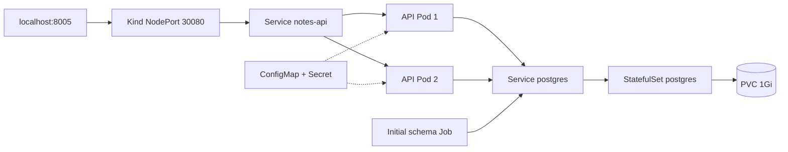

# Entendendo as peças do cluster

[English](guide.en.md) · [Voltar ao projeto](../README.md)

Execute os comandos na raiz deste repositório.

## Do Docker ao Kubernetes



A imagem da aplicação continua a mesma. O que muda é a forma de declarar e observar o ambiente:

| Peça | Papel neste laboratório |
| --- | --- |
| kind | Cria um control plane e um worker como containers Docker |
| Namespace | Separa os recursos da aplicação em `notes-lab` |
| Deployment | Mantém duas réplicas da API e gerencia seus rollouts |
| Service | Seleciona Pods pelas labels e fornece um endereço estável |
| ConfigMap | Guarda host, banco e usuário da conexão |
| Secret | Guarda a senha, montada como arquivo nos Pods |
| StatefulSet | Mantém a identidade do PostgreSQL e seu vínculo com o volume |
| PVC | Solicita 1Gi à StorageClass `standard` do kind |
| Job | Cria a tabela inicial antes de subir a API |

Os manifests estão em `manifests/`. `lab.sh up` aplica namespace e Secret, sobe o banco, aguarda prontidão, executa o Job e só então aplica a API. O Job usa o `migrate.py` existente na imagem; ele faz `CREATE TABLE IF NOT EXISTS`, sem migrações versionadas. Isso também evita duas réplicas disputando a criação inicial da tabela. O comando de entrada da API continua fazendo sua verificação de esquema no startup.

## Isolamento e preparação

Versões fixadas: kind 0.33.0, Kubernetes 1.37.0 e kubectl 1.37.1. A imagem dos nós, a API e o PostgreSQL são fixados por digest. Os downloads dos binários são comparados com os checksums oficiais; não há verificação independente de assinatura desses checksums.

A preparação instala ferramentas apenas em `.local/bin/` e preserva a senha existente. O kubeconfig também fica em `.local/`, com permissão 0600 quando o sistema de arquivos aplica permissões Linux. Em NTFS/DrvFS, considere também as ACLs do Windows. Nunca publique esse arquivo ou o conteúdo de Secrets.

O cluster usa containers privilegiados, como é normal no kind, e requer autoridade de acesso ao Docker. Planeje alguns GB de memória e espaço para as imagens. O teste local usou WSL com cerca de 15GiB de RAM disponíveis ao Linux. Outros ambientes podem ter limites diferentes.

O script se recusa a adotar um cluster `devops-notes` já existente sem seu marcador `.local/cluster-owned`. Ele passa explicitamente kubeconfig e contexto aos comandos. Criar este projeto não depende dos clusters ou credenciais de outros labs.

## Probes e dependência do banco

- Startup e readiness da API usam `/readyz`, que consulta o banco e a tabela.
- Liveness usa `/healthz`, que indica que o processo HTTP está vivo.
- PostgreSQL usa `pg_isready`; ele verifica disponibilidade do servidor, sem representar uma auditoria completa da aplicação ou autenticação.

Se o banco ficar indisponível, a API pode continuar viva enquanto deixa de estar pronta. O Service usa readiness para retirar Pods dos endpoints prontos. As probes não oferecem alta disponibilidade a um banco de réplica única.

## Guardar dados não é fazer backup

O StatefulSet usa o PVC `data-postgres-alpine-0`. O volume local fica associado ao worker. Substituir o Pod do banco mantém esse claim; excluir o cluster remove o nó e seus dados. A perda de nó continua fora deste teste; restauração lógica e rollback agora estão no [procedimento de adoção](postgres-adoption.md).

A política de retenção padrão do StatefulSet mantém o PVC se você remover só o StatefulSet. Excluir o namespace ou o cluster também remove os claims deste ambiente. Não use esses comandos como forma de pausar um estudo com dados que quer guardar.

## Ver e mudar o ambiente

```bash
bash scripts/k.sh get nodes
bash scripts/k.sh get pods -o wide
bash scripts/k.sh get pvc,jobs
bash scripts/k.sh logs deployment/notes-api --tail=30
bash scripts/k.sh get endpointslices -l kubernetes.io/service-name=notes-api
bash scripts/k.sh scale deployment/notes-api --replicas=3
bash scripts/k.sh rollout status deployment/notes-api
bash scripts/k.sh apply -f manifests/api.yaml
```

O wrapper usa o namespace `notes-lab` por padrão. A porta 8005 do host está vinculada apenas a `127.0.0.1`, mapeada à NodePort 30080 no control plane. Você não precisa manter um processo de port-forward aberto. O banco só tem Services internos.

## Uma atualização que não funciona

```bash
bash scripts/k.sh set image deployment/notes-api api=ghcr.io/tommmdl/docker-lab:missing-exercise
bash scripts/k.sh get pods
bash scripts/k.sh get events --sort-by=.metadata.creationTimestamp
bash scripts/k.sh rollout undo deployment/notes-api
bash scripts/k.sh rollout status deployment/notes-api
```

A estratégia usa `maxUnavailable: 0` e `maxSurge: 1`: pode criar um Pod extra, mantendo as réplicas antigas prontas enquanto a nova imagem falha. Isso é o comportamento exercitado aqui, não uma garantia geral de disponibilidade sem falhas. O teste usa uma tag aleatória inexistente, espera um erro de pull e confere a API antiga antes de desfazer a mudança.

## Cuidados com configuração

A API roda como UID 10001, com capabilities removidas, sem escalada de privilégios e com rootfs somente leitura. `/tmp` usa emptyDir em memória. O PostgreSQL roda como UID/GID 70 e grava no volume. Pods não recebem automaticamente tokens de ServiceAccount.

O Secret é criado a partir de `.local/db-password`, sem incluir seu conteúdo nos manifests versionados. Base64 em um Secret não é criptografia por si só; não foi configurado um cofre ou criptografia de Secrets em repouso. O usuário `lab` do banco tem os privilégios administrativos da imagem de laboratório. Não há TLS ou autenticação de usuários na API.

Ao perder ou mudar a senha local de um banco já inicializado, não basta recriar o Secret: planeje a rotação no banco também. O Job de esquema mantém nome e spec fixos; para outro esquema/imagem, planeje um novo Job ou remova explicitamente o Job antigo antes de reaplicar, respeitando a imutabilidade de Jobs.

## Testes e diagnóstico

`tests/verify.py` trabalha apenas no contexto dedicado. Confere cluster, replicas, Job, PVC, HTTP, substituição de Pods, escala e rollback. Ele usa uma nota própria e remove apenas essa nota. A troca do Pod PostgreSQL interrompe brevemente conexões; não representa um banco tolerante à perda de nó.

Se o teste falhar, examine os logs em `.local/` e o estado antes de tentar novamente. A rotina tenta restaurar imagem/escala em falhas durante o rollout. Uma falha mais cedo pode deixar recursos ou uma nota de teste para investigação. Não apague namespace/cluster como primeira tentativa de resolver um erro de banco.

No CI, o mesmo teste roda em Ubuntu 24.04. O runner remove seu cluster depois de guardar os resultados. Artefatos selecionados duram 14 dias e não incluem senha ou kubeconfig. O token tem `contents: read` e as Actions são fixadas por SHA.

- Docker permission denied: confira o acesso ao daemon e a integração WSL. Neste ambiente, os comandos Docker exigiram execução autorizada fora do sandbox.
- Worker não fica pronto: consulte logs do container e recursos disponíveis. Se observar `inotify_init: too many open files`, investigue os limites do host antes de ajustá-los. O script não altera sysctl automaticamente.
- API Pending: examine eventos, requests e PVC. Ambos os nós compartilham recursos reais da mesma máquina.
- API CrashLoopBackOff: veja logs e a conexão com PostgreSQL; confira o Secret sem expor seu valor.
- PVC Pending: confira a StorageClass `standard` e o provisionador local do kind.
- Porta 8005 ocupada: ajuste o hostPort em `cluster/kind.yaml` antes de criar o cluster e a URL nos testes.

## Encerrar

```bash
bash scripts/lab.sh down
```

Apaga só o cluster `devops-notes` com marcador deste checkout, incluindo os dados persistentes dentro dele. A pasta do projeto e a senha local permanecem. Recriar um cluster produz um banco vazio.

## Leituras úteis

- [Configuração do kind](https://kind.sigs.k8s.io/docs/user/configuration/)
- [Deployments](https://kubernetes.io/docs/concepts/workloads/controllers/deployment/)
- [StatefulSets](https://kubernetes.io/docs/concepts/workloads/controllers/statefulset/)
- [Volumes persistentes](https://kubernetes.io/docs/concepts/storage/persistent-volumes/)
- [Probes](https://kubernetes.io/docs/tasks/configure-pod-container/configure-liveness-readiness-startup-probes/)
